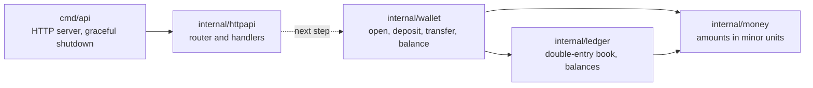
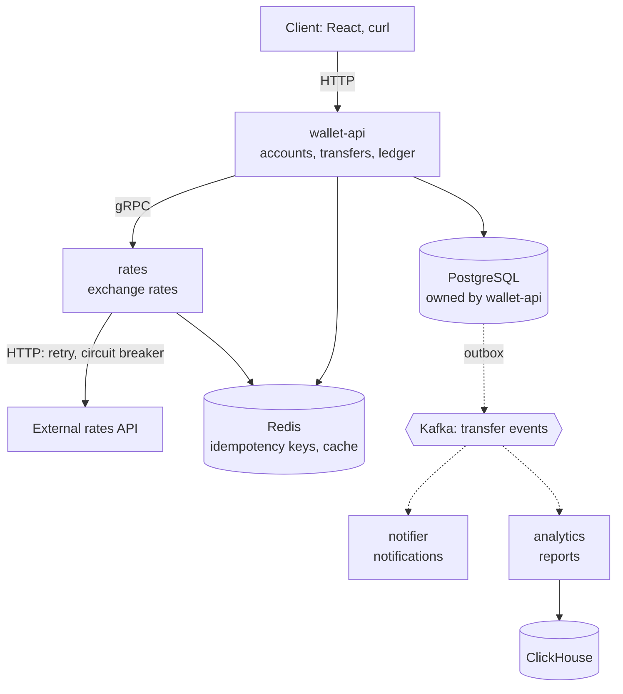

# Wallet

[](https://github.com/IvanShchadov/wallet/actions/workflows/ci.yml)

A multi-currency wallet backend in Go with a double-entry ledger — a production-style pet project.

## Why

My pet project to show how a fintech backend is built end to end: money as integer minor units,
a double-entry ledger, transfers in a single database transaction, idempotent requests,
events via Kafka with the outbox pattern, analytics in ClickHouse, and deployment to Kubernetes.
It grows in small working stages — the roadmap shows where it is now.

## Architecture

### Now

One service, `wallet-api`. The domain works in memory; over HTTP it only answers the health check so far.
An arrow means "imports". The dotted link is the next step, the REST API.



- `money` — an amount in integer minor units plus a currency, no floats.
- `ledger` — an append-only book: every transaction sums to zero in each currency,
  and a customer account never goes below zero.
- `wallet` — the use cases. They depend on a small `Ledger` interface, so the in-memory book
  can be swapped for PostgreSQL without touching them.

### Target



Solid arrows are synchronous calls, dotted arrows are events through Kafka.
The core — accounts, transfers and the ledger — stays one service, because a transfer must run
in one database transaction. Only the parts with a reason to live apart are split out:
`rates` wraps an external dependency, `notifier` and `analytics` react to events on their own.
Each service owns its data and runs in its own container: Docker Compose locally, Kubernetes later.

## Getting started

You need Go 1.26 and Docker.

```sh
go test -race ./...
go run ./cmd/api
curl localhost:8080/healthz
```

In Docker:

```sh
docker build -t wallet-api:0.1 .
docker run --rm -p 8080:8080 wallet-api:0.1
```

PostgreSQL for the next stages runs in Docker Compose on `localhost:5433`:

```sh
docker compose up -d
```

In a local Kubernetes cluster (with kind, run `kind load docker-image wallet-api:0.1` first):

```sh
kubectl apply -f deploy/k8s/wallet-api.yaml
kubectl get pods -l app=wallet-api
```

## Roadmap

<!-- Строки = этапы плана, по порядку -->
- [x] Repository setup: healthcheck, graceful shutdown, multi-stage Dockerfile
- [x] Domain: money in minor units, accounts, double-entry ledger with an overdraft check
- [x] CI: vet and race tests on every push, image to GHCR from `main`
- [ ] REST API for accounts and transfers on the in-memory ledger
- [ ] PostgreSQL: schema and migrations, a transfer in one transaction with `SELECT ... FOR UPDATE`, integration tests in CI
- [ ] Redis: idempotent transfers (`Idempotency-Key`), cache, rate limiting
- [ ] Rates as a separate gRPC service, currency exchange via quotes: timeouts, retries with backoff, circuit breaker
- [ ] Kafka: transfer events via the transactional outbox, notifier service, idempotent consumers
- [ ] ClickHouse: analytics service with turnover reports
- [ ] Docker and CI/CD: Compose for the whole system, linters and vulnerability checks, an image per service, deploy
- [ ] Kubernetes: all services in a local kind cluster, the core on a VPS with k3s
- [ ] Observability: logs, metrics, dashboards, alerts
- [ ] AWS through LocalStack: S3 for statements, SQS
- [ ] React UI: accounts, transfers, history, live rates

## Out of scope

<!-- Чего нет намеренно. Так видно, что граница — решение, а не недоделка -->
- Real payment providers and cards
- KYC
